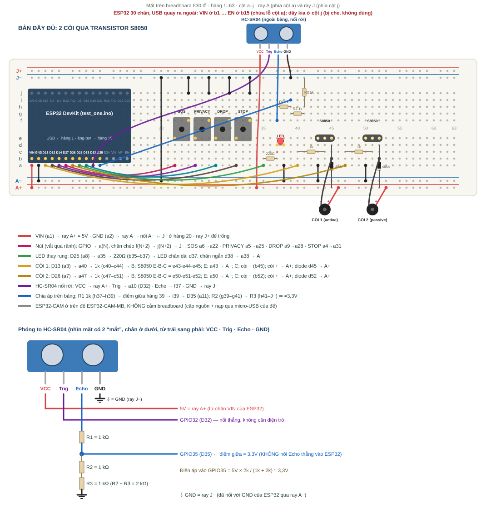
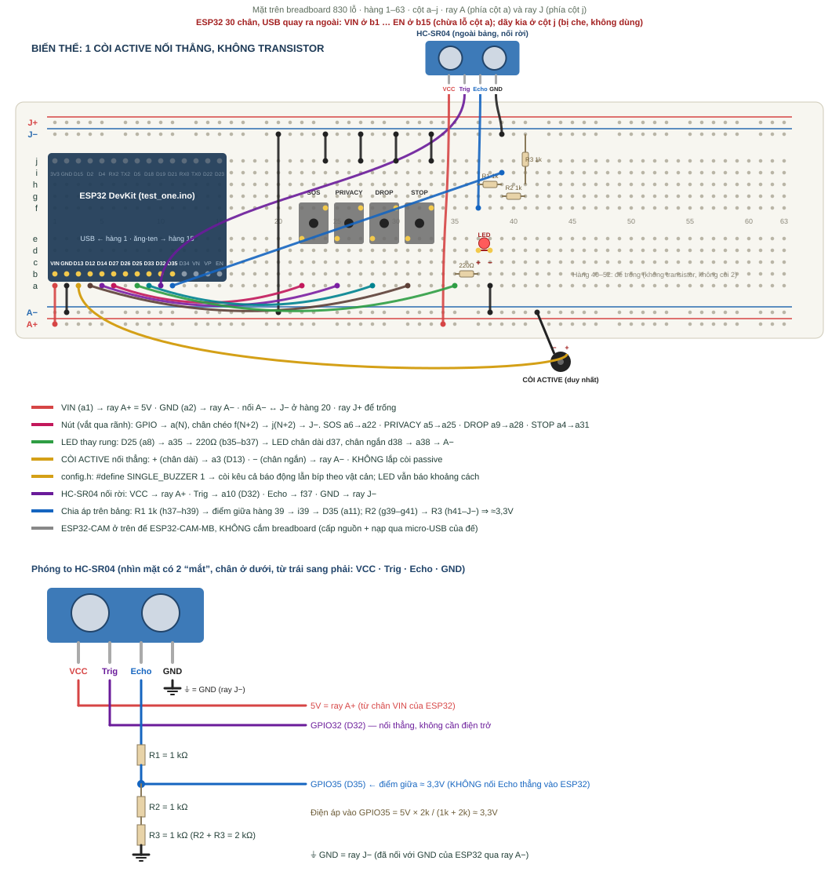

# 12 — Hướng dẫn từng bước: ESP32 trên breadboard 830 lỗ + ESP32-CAM trên đế MB

Cấu hình này dùng `PROJECT_MODE=duo`:

- **ESP32 DevKit** (sketch `firmware/test_one`) giữ HC-SR04, 4 nút, còi và **LED thay cho mô-tơ rung**. Mọi dây chỉ nối vào **một dãy chân** của ESP32 (mục 3.1).
- **ESP32-CAM AI Thinker + OV2640** (sketch `firmware/camera`) **giữ nguyên trên đế ESP32-CAM-MB**, không cắm breadboard. Nó chỉ chụp ảnh khi máy chủ yêu cầu; nạp code và lấy nguồn 5 V qua cổng micro-USB của đế.
- **Máy chủ trên laptop** chạy web, SegFormer-B0 và gửi tin nhắn cho người nhà qua web/app.
- **Điện thoại người đeo** (tùy chọn) chia sẻ GPS.

Hai bo **không nối dây nào với nhau**, kể cả GND; chúng nói chuyện qua Wi-Fi với máy chủ. Vì vậy ESP32-CAM không cần dùng GPIO1/3/4 làm nút, vẫn xem được log qua đế MB và nạp lại dễ dàng.

Làm theo đúng thứ tự: **phần mềm → máy chủ → lắp mạch (chưa cấp điện) → nạp ESP32 → nạp ESP32-CAM → web/app → thử từng chức năng**.

## Bước 0 — Chuẩn bị

| Linh kiện | Số lượng | Ghi chú |
|---|---|---|
| ESP32 DevKit V1 **30 chân** (DOIT, chip CP2102 hoặc CH340) | 1 | Bố trí lỗ bên dưới giả định loại 30 chân. Loại 38 chân rộng hơn, xem mục “Nếu bo không vừa” |
| ESP32-CAM AI Thinker + camera OV2640 (cáp ghi TY-OV2640-2.1MM: ống kính góc rộng 2,1 mm) | 1 | Cáp camera phải cắm chặt, khóa đen gập xuống. Không cần thẻ microSD |
| Đế nạp ESP32-CAM-MB (micro-USB, nút RST và IO0) | 1 | Dùng để nạp code **và** cấp nguồn |
| Cáp micro-USB có dây dữ liệu + cục sạc **5 V ≥ 1 A** (nên 2 A) | 1 | Cấp nguồn cho ESP32-CAM khi chạy độc lập |
| Breadboard 830 lỗ | 1 | |
| Cảm biến HC-SR04 | 1 | Cái thứ hai để dự phòng |
| LED 5 mm + điện trở 220 Ω | 1 + 1 | Thay mô-tơ rung |
| Điện trở 1 kΩ | 5 | 3 cái chia áp chân ECHO (5 V → 3,3 V) + 2 cái cho chân B của transistor |
| Nút nhấn 4 chân 6×6 mm | 4 | SOS, PRIVACY, DROP, STOP |
| Còi active **2 chân** | 1 | Còi 1: báo SOS, rơi gậy, tìm gậy |
| Còi passive **2 chân** | 1 | Còi 2: bíp theo khoảng cách. Không có thì dùng `SINGLE_BUZZER 1` |
| Transistor NPN **S8050** (hoặc 2N2222/PN2222A) | 2 | Mỗi còi một cái; ESP32 không cấp đủ dòng cho còi |
| Diode 1N4148 hoặc 1N4007 | 2 | Nên có, bảo vệ transistor |
| Dây đực–đực (~25) và **dây đực–cái (~8)** | | Đực–cái để nối rời HC-SR04 (4 dây) và 2 còi (4 dây) |
| Cáp USB **có dây dữ liệu** cho ESP32 | 1 | Cáp chỉ để sạc sẽ không nạp được |
| Đồng hồ vạn năng | 1 | Rất nên có để đo điện trở, điện áp và kiểm tra ray |

Phần mềm trên laptop Windows (máy này đã có Python 3.12 và Arduino IDE 2):

1. **Python 3.12** từ python.org.
2. **Arduino IDE 2**. Vào *File → Preferences → Additional boards manager URLs*, thêm `https://espressif.github.io/arduino-esp32/package_esp32_index.json`. Vào *Boards Manager* cài **esp32 by Espressif Systems** (đã kiểm tra với 3.3.12). Vào *Library Manager* cài **ArduinoJson** của Benoit Blanchon (đã kiểm tra với 7.4.3).
3. **Driver USB** theo chip trên bo: CP210x (Silicon Labs) hoặc CH340 (WCH). Đế ESP32-CAM-MB thường dùng CH340. Cắm từng bo vào máy; *Device Manager → Ports* phải hiện `COMx` (hai bo có hai số COM khác nhau).
4. **cloudflared** (để có HTTPS cho điện thoại): `winget install --id Cloudflare.cloudflared`.

## Bước 1 — Chạy máy chủ lần đầu

1. Mở thư mục `dong-hanh-hop-nhat`, **nhấp đúp `start-windows.cmd`**. Lần đầu script sẽ:
   - tạo `.venv`;
   - cài `requirements.txt`, gồm FastAPI và pywebpush;
   - cài thư viện AI bản CPU (torch + torchvision + transformers, **vài trăm MB**, cần Internet);
   - tạo `.env` với các khóa ngẫu nhiên;
   - in địa chỉ IPv4 của laptop rồi chạy máy chủ ở cổng 8000.
2. Windows hỏi tường lửa: chọn **Private networks** (mạng riêng). Không tắt toàn bộ tường lửa.
3. Mở `.env` bằng Notepad, kiểm tra các dòng sau:
   - `PROJECT_MODE=duo`
   - `AI_PROVIDER=segformer`
   - `AI_MODEL_DIR=ai/model-baseline`

   Đây chính là SegFormer-B0 ADE20K bạn đã tải; file trọng số giống hệt bản trong cache HuggingFace. Sửa `.env` xong phải **tắt máy chủ (Ctrl+C) và chạy lại**.
4. Ghi lại ba khóa sẽ dùng: `TEST_TOKEN` cho ESP32, `CHEST_TOKEN` cho ESP32-CAM, `CAREGIVER_TOKEN` cho người nhà (thêm `PHONE_TOKEN` nếu dùng GPS điện thoại).
5. Ghi lại **IPv4** script in ra, ví dụ `192.168.1.10`. Khi dùng hotspot iPhone, địa chỉ thường có dạng `172.20.10.x`.
6. Mở `http://localhost:8000` → **Kết nối máy chủ** → để trống địa chỉ, dán `CAREGIVER_TOKEN`. Trang **Kết nối & cài đặt** phải hiện “SegFormer-B0 trên máy chủ”.

Laptop và hai bo phải cùng một mạng Wi-Fi **2,4 GHz**. Nếu dùng hotspot iPhone, bật *Tối đa hóa tương thích* để phát sóng 2,4 GHz. Từ điện thoại cùng mạng, mở `http://<IPv4>:8000/health` phải thấy `{"ok":true}`. Không thấy thì ESP32 cũng sẽ không kết nối được.

## Bước 2 — Hiểu breadboard 830 lỗ



- Có **63 hàng** (1–63) và **10 cột** (a–j), chia hai nửa a–e và f–j bởi **rãnh giữa**.
- Năm lỗ **cùng hàng, cùng nửa** (ví dụ a8–e8) nối với nhau. Hai nửa không nối nhau.
- Hai bên có **ray nguồn** chạy dọc. Trong tài liệu này:
  - **ray A+ / A−** là cặp ray phía cột a: A+ = 5 V lấy từ chân VIN của ESP32, A− = GND;
  - **ray J+ / J−** là cặp ray phía cột j: J− = GND, **J+ để trống** (không dùng).
- Một số breadboard 830 có **ray bị ngắt ở giữa** (vạch đỏ/xanh đứt quãng quanh hàng 31–32). Dùng đồng hồ đo thông mạch giữa đầu và cuối ray. Nếu bị ngắt, thêm một dây nối hai nửa của mỗi ray.

## Bước 3 — Lắp mạch (KHÔNG cắm USB, KHÔNG cấp nguồn)

Tắt mọi nguồn khi cắm hay rút dây. Mỗi bảng bên dưới là một khối mạch; lắp xong khối nào thì đánh dấu khối đó. Trên breadboard có ESP32, nút, LED, điện trở, diode và 2 transistor. **HC-SR04 và 2 còi nằm ngoài, nối rời bằng dây đực–cái.** Từ hàng 54 trở đi để trống.

### 3.0 Nguyên tắc: cắm lệch lỗ vẫn chạy, miễn đúng “điểm nối”

Số lỗ trong các bảng chỉ là **gợi ý**. Mạch chạy đúng khi **đúng những chân được nối với nhau**, gọi là các **điểm nối**. Lệch vài hàng không sao.

**4 quy tắc của breadboard:**

1. **5 lỗ cùng hàng, cùng nửa** (a–e hoặc f–j) là **một điểm nối**. Hai thứ cắm chung nhóm 5 lỗ đó là đã nối với nhau.
2. **Rãnh giữa ngăn cách**: a–e của hàng 10 **không** nối với f–j của hàng 10.
3. **Mỗi ray** là một điểm nối chạy dọc cả bảng. Nếu ray bị ngắt ở giữa (xem bước 2) thì thêm dây nối hai nửa.
4. **Hai chân của cùng một linh kiện không được nằm chung nhóm 5 lỗ**. Ví dụ điện trở có hai chân cùng hàng 39 thì bị nối tắt, coi như không có.

**Bảng điểm nối phải đúng** (mỗi dòng là một điểm nối; chỉ các chân trong dòng đó được chạm nhau):

| Điểm nối | Gồm đúng các chân sau |
|---|---|
| **5V** | ESP32 **VIN** · ray A+ · HC-SR04 **VCC** · chân **+** (chân dài) của 2 còi · đầu có vạch của 2 diode |
| **GND** | ESP32 **GND** · ray A− · ray J− · HC-SR04 **GND** · chân **E** của 2 transistor · chân ngắn LED · chân cuối R3 · một chân của mỗi nút |
| **TRIG** | ESP32 **D32** · HC-SR04 **Trig** |
| **ECHO 5V** | HC-SR04 **Echo** · một chân **R1**. Không có gì khác |
| **ĐIỂM GIỮA ≈3,3V** | chân còn lại của **R1** · một chân **R2** · ESP32 **D35** |
| **Giữa R2–R3** | chân còn lại của **R2** · một chân **R3** (chân kia của R3 vào GND) |
| **Còi 1 – vào** | ESP32 **D13** · một chân điện trở 1 kΩ (R4) |
| **Còi 1 – B** | chân kia R4 · chân **B** transistor 1 |
| **Còi 1 – C** | chân **C** transistor 1 · chân **−** (chân ngắn) còi 1 · đầu không vạch của diode 1 |
| **Còi 2 – vào / B / C** | giống còi 1, với **D26**, điện trở R5, transistor 2, còi 2, diode 2 |
| **LED** | ESP32 **D25** · một chân điện trở 220 Ω; chân kia điện trở · **chân dài LED** |
| **Nút** | ESP32 D27 / D14 / D33 / D12 · một chân của nút SOS / PRIVACY / DROP / STOP; **chân chéo** của nút · GND |

**Tuyệt đối không được có:**
- **Echo** nối thẳng vào bất kỳ chân ESP32 nào;
- **5V chạm GND**;
- **5V chạm bất kỳ chân GPIO nào**;
- hai chân GPIO khác nhau chung một điểm nối.

**Khi cắm lệch, kiểm tra 4 điều:**
1. Không cắm vào các hàng 1–15 ngoài cột a, vì ở đó đã có chân ESP32 bên dưới.
2. Mỗi điện trở, LED và nút có hai chân ở **hai hàng khác nhau**.
3. Đầu dây và chân linh kiện cần nối với nhau nằm **cùng hàng, cùng nửa**.
4. Một hàng đã dùng cho điểm nối này thì không cắm chân của điểm nối khác vào cùng hàng đó.

**Đo bằng đồng hồ khi CHƯA cấp điện** (đặt thang Ω, đo trực tiếp từ chân linh kiện, không đo lỗ):

| Đo giữa | Kết quả đúng |
|---|---|
| Trig HC-SR04 ↔ chân D32 | ≈ 0 Ω (kêu bíp) |
| Echo HC-SR04 ↔ chân D35 | ≈ 1 kΩ |
| Chân D35 ↔ GND | ≈ 2 kΩ (có thể lệch chút vì mạch bên trong ESP32) |
| Echo HC-SR04 ↔ GND | ≈ 3 kΩ |
| VCC HC-SR04 ↔ chân VIN | ≈ 0 Ω |
| Chân D13 ↔ chân B transistor 1; D26 ↔ B transistor 2 | ≈ 1 kΩ |
| Chân C transistor ↔ GND | **không** kêu bíp (kêu bíp là cắm đảo E/C) |
| Chân − còi ↔ chân C transistor | ≈ 0 Ω |
| Ray A+ ↔ ray A− | **không** kêu bíp |

**Khi đã cấp điện:**
- Ray A+ so với GND ≈ 4,6–5 V.
- Serial Monitor in `[do] … cm` và số thay đổi khi đưa tay lại gần.

### 3.1 Cắm ESP32 — vì sao chỉ dùng MỘT dãy chân

ESP32 DevKit rộng khoảng 1 inch. Khi cắm vắt qua rãnh giữa, bo che gần hết bề ngang và **chỉ còn trống một cột** (a hoặc j). Dãy chân ở phía bị che **không cắm thêm dây vào được**. Vì vậy firmware đã được sắp để **mọi chân cần dùng nằm trên cùng một dãy**: dãy có **VIN (hoặc 5V), GND, D13, D12, D14, D27, D26, D25, D33, D32, D35, D34**. Dãy còn lại (D23, D22, TX0, RX0, D21, D19, D18, D5, TX2, RX2, D4, D2, D15, GND, 3V3) **không dùng**.

Cách cắm (bo 30 chân):

1. Lật bo, đọc nhãn chân. Tìm dãy có chữ **VIN** và **D25, D26, D27**. Đó là “dãy dùng”.
2. Cho **cổng USB quay ra ngoài mép breadboard** (phía hàng 1) để dễ cắm cáp. Thân bo nằm trên hàng 1–15.
3. Cắm sao cho **dãy dùng nằm ở cột b**: **VIN ở b1, EN ở b15**, và **cột a ngay cạnh còn trống**. Dãy kia rơi vào cột j và bị che; như vậy là đúng.
4. Ấn đều hai dãy chân cho bo nằm phẳng. Mỗi lỗ cột a giờ là **lỗ nối với chân bên cạnh nó**: cắm dây vào lỗ a cùng hàng với chân nào thì nối với chân đó.

### 3.2 Vị trí chân trên “dãy dùng” (USB quay ra ngoài, VIN ở b1 … EN ở b15)

| Hàng | Chân (cột b) | Dùng cho | Lỗ cắm dây |
|---|---|---|---|
| 1 | **VIN** | 5 V từ USB | **a1** |
| 2 | **GND** | GND | **a2** |
| 3 | **D13** | Còi 1 (active) | **a3** |
| 4 | **D12** | Nút STOP | **a4** |
| 5 | **D14** | Nút PRIVACY | **a5** |
| 6 | **D27** | Nút **SOS** | **a6** |
| 7 | **D26** | Còi 2 (passive) | **a7** |
| 8 | **D25** | **LED** (thay rung) | **a8** |
| 9 | **D33** | Nút DROP | **a9** |
| 10 | **D32** | **TRIG** của HC-SR04 | **a10** |
| 11 | **D35** | **ECHO** (qua chia áp) | **a11** |
| 12 | D34 | (biến trở giả lập, tùy chọn) | a12 |
| 13–14 | VN, VP | — | — |
| 15 | EN | — | — |

Trước khi đi tiếp, **đối chiếu từng dòng bảng với nhãn in trên bo của bạn**. Nếu một chân nằm ở hàng khác, cứ cắm dây vào lỗ a **cùng hàng với chân có tên đó**; tên chân mới là thứ quyết định.

### 3.3 Nguồn và GND

| Từ | Đến | Ý nghĩa |
|---|---|---|
| a1 (VIN) | ray **A+** | 5 V từ USB laptop (cho HC-SR04 và 2 còi) |
| a2 (GND) | ray **A−** | GND |
| ray A− (hàng 20) | ray **J−** (hàng 20) | Đưa GND sang ray bên kia. Ray J+ để trống |

### 3.4 Bốn nút nhấn (vắt qua rãnh giữa)

Nút 4 chân cắm vắt qua rãnh: chân ở e(N), f(N), e(N+2), f(N+2). Chỉ dùng **hai chân chéo nhau**: chân **e(N)** nối GPIO (qua lỗ a(N) cùng dải), chân **f(N+2)** nối GND (qua lỗ j(N+2)). Cách này đúng dù nút xoay theo chiều nào. Không cần điện trở: firmware bật điện trở kéo lên bên trong chip.

| Nút | Cắm nút tại | Dây GPIO | Dây GND |
|---|---|---|---|
| **SOS** | e22, f22, e24, f24 | a6 (D27) → **a22** | **j24** → ray J− |
| **PRIVACY** | hàng 25–27 | a5 (D14) → **a25** | **j27** → ray J− |
| **DROP** | hàng 28–30 | a9 (D33) → **a28** | **j30** → ray J− |
| **STOP** | hàng 31–33 | a4 (D12) → **a31** | **j33** → ray J− |

### 3.5 LED thay mô-tơ rung (GPIO25)

| Từ | Đến |
|---|---|
| a8 (D25) | **a35** |
| Điện trở **220 Ω** (đỏ-đỏ-nâu) | **b35 – b37** |
| LED **chân dài (+)** | **d37** |
| LED **chân ngắn (−)** | **d38** |
| a38 | ray **A−** |

Khi có vật cản trong 40–120 cm, LED nháy nhanh dần và sáng mạnh hơn khi lại gần. LED cũng nháy theo SOS, phản hồi nút riêng tư và lỗi đo. Sau này có mô-tơ thì lắp vào GPIO25 qua MOSFET theo [tài liệu 02](02-lap-va-nap-1-esp32.md); không cần sửa code.

### 3.6 Hai còi 2 chân — qua transistor S8050, còi nối rời

Không nối còi 2 chân thẳng vào chân ESP32. Còi cần khoảng 30 mA và 5 V; chân ESP32 không cấp nổi, kêu nhỏ và có thể hỏng chân GPIO. Transistor **S8050** làm công tắc: ESP32 chỉ cấp vài mA vào chân B, còn dòng cho còi đi từ ray 5 V.

**Nhận biết còi:**
- **Active:** đáy kín (thường có tem dán). Cấp 5 V là kêu liên tục. Dùng làm **còi 1** (GPIO13): báo SOS, rơi gậy, tìm gậy.
- **Passive:** đáy hở, thấy mạch xanh. Cấp 5 V chỉ kêu “tách” một cái. Dùng làm **còi 2** (GPIO26): bíp theo khoảng cách. Firmware tự tạo tiếng 2,2 kHz cho còi này.
- Cả hai loại: **chân dài là +**, mặt trên thường có dấu +.

**Nhận biết chân S8050:** mặt phẳng có chữ **quay về phía bạn**, chân chĩa xuống, từ trái sang phải là **E – B – C**. 2N2222/PN2222A vỏ nhựa cũng thường là E – B – C. Nếu loại của bạn khác, xem datasheet hoặc đo bằng thang diode.

**Trên breadboard** (transistor cắm ở cột e, 3 chân nằm 3 hàng liền nhau):

| | Còi 1 (active, D13) | Còi 2 (passive, D26) |
|---|---|---|
| Dây từ ESP32 | a3 → **a40** | a7 → **a47** |
| Điện trở 1 kΩ | **c40 – c44** | **c47 – c51** |
| S8050: E, B, C | **e43, e44, e45** | **e50, e51, e52** |
| E → GND | **a43** → ray A− | **a50** → ray A− |
| Diode: đầu **không vạch** ở hàng C, đầu **có vạch** cắm ray A+ | **d45** → ray A+ | **d52** → ray A+ |

**Còi nối rời bằng 2 dây đực–cái mỗi còi:**

| Chân còi | Còi 1 | Còi 2 |
|---|---|---|
| **−** (chân ngắn) | **b45** (hàng chân C) | **b52** (hàng chân C) |
| **+** (chân dài) | ray **A+** | ray **A+** |

Không có diode thì còi vẫn kêu; diode chỉ bảo vệ transistor khi dùng lâu dài. **Code:** giữ mặc định `BUZZER_ACTIVE_LOW 0`. Chỉ có 1 còi active thì bỏ khối còi 2 và đặt `#define SINGLE_BUZZER 1`.

**Kiểm tra:**
- **Chưa cấp điện:** chân C ↔ GND **không** kêu bíp; D13 ↔ chân B ≈ 1 kΩ.
- **Đã cấp điện:** giữ SOS 1,5 giây, còi 1 phải hú; đưa tay lại gần HC-SR04, còi 2 phải bíp nhanh dần.
- **Còi kêu mãi không tắt:** E và C đang cắm đảo, hoặc chân B không đi qua điện trở 1 kΩ tới đúng D13/D26.

### 3.6b Không có S8050

**Cách 1 — dùng transistor NPN khác (vẫn đủ cả 2 còi).** Đọc chữ in trên mặt phẳng transistor. Mạch giữ nguyên như mục 3.6, chỉ **thứ tự chân khác**: hãy cắm sao cho chân **E** vào hàng nối GND, **B** vào hàng có điện trở 1 kΩ, **C** vào hàng nối chân − của còi.

| Mã in trên transistor | Loại | Thứ tự chân (mặt phẳng có chữ quay về phía bạn, chân chĩa xuống, trái → phải) |
|---|---|---|
| S8050, S9013, S9014, 2N3904, PN2222A / 2N2222A (vỏ nhựa) | NPN, dùng được | **E – B – C** (giống mục 3.6) |
| C1815 (2SC1815) | NPN, dùng được | **E – C – B** (chú ý đảo) |
| BC547, BC548, BC337 | NPN, dùng được | **C – B – E** (ngược hoàn toàn) |
| S8550, S9012, S9015, A1015, BC557 | **PNP, KHÔNG dùng** cho mạch này | — |

Không chắc thứ tự chân thì tra datasheet, hoặc đo bằng thang diode: chân **B** là chân mà que **đỏ** đặt lên thì đo được khoảng 0,6–0,7 V sang **cả hai** chân còn lại.

**Cách 2 — không có transistor nào: chỉ dùng còi 1 (active), nối thẳng.**



Sơ đồ [breadboard-duo-1coi.svg](breadboard-duo-1coi.svg) giống hệt sơ đồ đầy đủ, chỉ khác phần còi: không có transistor, điện trở 1 kΩ, diode hay còi 2; hàng 40–52 để trống.

Còi active loại nhỏ (đường kính khoảng 12 mm, ghi 3–5 V) hút khoảng 15–20 mA ở 3,3 V. Một chân ESP32 cấp được mức này, tiếng sẽ nhỏ hơn khi chạy 5 V. **Không** làm vậy với còi passive: cuộn dây bên trong có điện trở rất thấp, sẽ kéo dòng quá lớn và có thể hỏng chân GPIO.

| Chân còi active | Nối tới |
|---|---|
| **+** (chân dài) | **a3** (cạnh chân D13), nối thẳng, **không** qua điện trở |
| **−** (chân ngắn) | ray **A−** |

1. Bỏ toàn bộ khối transistor, điện trở 1 kΩ và diode của mục 3.6, và **không lắp còi 2**.
2. Thêm vào `firmware/test_one/config.h`:

```cpp
#define SINGLE_BUZZER 1
```

Khi đó còi 1 kêu cả **báo động** (SOS, rơi gậy, tìm gậy) lẫn **bíp theo vật cản**; vật cản ≤ 40 cm được ưu tiên. LED (mục 3.5) vẫn nháy theo khoảng cách như cũ.

Nếu ESP32 tự khởi động lại khi còi kêu, hoặc chân còi nóng, thì còi đó hút quá nhiều dòng: rút ra và dùng cách 1. Khi mua thêm transistor, chuyển sang mạch mục 3.6 và xóa dòng `SINGLE_BUZZER`.

### 3.7 HC-SR04 — nối rời bằng 4 dây đực–cái

Nhìn **mặt có 2 “mắt”**, chân ở dưới, từ trái sang phải: **VCC · Trig · Echo · GND** (tên chân in trên mạch). Chụp **đầu cái** của 4 dây vào 4 chân này, đến hết phần kim loại. Dùng màu gợi ý: **đỏ = VCC, tím = Trig, xanh = Echo, đen = GND**. Dán băng keo gom dây vào thân cảm biến cho khỏi tuột.

Chân Echo phát ra **5 V**, nhưng chân ESP32 chỉ chịu **3,3 V**. Vì vậy Echo phải đi qua **mạch chia áp 3 điện trở 1 kΩ** (nâu-đen-đỏ) **cắm trên breadboard** trước khi vào ESP32.

**Bước A — mạch chia áp trên breadboard (lắp trước):**

| # | Linh kiện / dây | Chân 1 | Chân 2 |
|---|---|---|---|
| 1 | **R1** 1 kΩ | **h37** | **h39** |
| 2 | **R2** 1 kΩ | **g39** | **g41** |
| 3 | **R3** 1 kΩ | **h41** | ray **J−** |
| 4 | Dây (xanh dương) | **i39** (điểm giữa) | **a11** (cạnh chân D35) |

Hàng 39 bên phải là **điểm giữa**: R1 đi vào, R2 đi ra, dây sang GPIO35. Điện áp ở đây ≈ 5 V × 2 kΩ / 3 kΩ ≈ **3,3 V**.

**Bước B — cắm đầu đực của 4 dây từ cảm biến:**

| Dây từ chân | Cắm đầu đực vào | Ghi chú |
|---|---|---|
| **VCC** (đỏ) | ray **A+** | 5 V |
| **Trig** (tím) | **a10** (cạnh chân D32) | Nối thẳng, không cần điện trở |
| **Echo** (xanh) | **f37** (hàng 37 bên phải, cùng hàng chân trên của R1) | **Không** cắm Echo vào cột a |
| **GND** (đen) | ray **J−** | |

Nếu cắm lệch hàng: Echo phải cắm vào **cùng hàng với đầu trên của R1**, và hàng đó **không có gì khác**.

**Bước C — kiểm tra khi chưa cấp điện** (đo từ chân cảm biến):
- Echo ↔ chân D35 ≈ 1 kΩ;
- Echo ↔ GND ≈ 3 kΩ;
- Trig ↔ chân D32 kêu bíp;
- VCC ↔ chân VIN kêu bíp;
- **không** có dây nào nối hàng 37 thẳng sang cột a.

**Bước D — khi đã nạp code:** Serial Monitor in `[do] 85 cm`, số đổi khi đưa tay lại gần. Hướng hai “mắt” về phía trước, không để dây hay tay che trước mắt. In `[do] khong do duoc` thì kiểm tra lại bảng A và B.

### 3.8 ESP32-CAM — để trên đế ESP32-CAM-MB, ngoài breadboard

1. Kiểm tra ESP32-CAM cắm **đúng chiều và sát** vào đế MB: các nhãn 5V/GND trên ESP32-CAM phải trùng nhãn tương ứng trên đế, không lệch một hàng chân.
2. Kiểm tra cáp camera OV2640: đầu cáp cắm hết vào khe, khóa đen gập xuống.
3. **Không cắm thẻ microSD.**
4. Lúc nạp code: cắm micro-USB của đế vào laptop.
5. Lúc chạy: cắm vào **cục sạc 5 V ≥ 1 A** (tốt nhất 2 A), hoặc vẫn để cắm laptop. Nếu log báo `Brownout` thì chuyển sang cục sạc hoặc cổng USB có nguồn riêng.
6. Đặt camera hướng về phía trước, ngang ngực, cách breadboard một chút để dây USB không kéo lệch hướng camera. Ống kính 2,1 mm góc rộng nên ảnh có méo ở mép; đó là bình thường.
7. Nếu ảnh trên web bị ngược hoặc lật gương, sửa trong `firmware/camera/config.h` rồi nạp lại:
   - ảnh ngược trên-dưới: `#define CAMERA_VFLIP 1`;
   - ảnh lật trái-phải: `#define CAMERA_HMIRROR 1`.

ESP32-CAM **không cần nối GND chung** với ESP32 hay breadboard, vì hai bo chỉ liên lạc qua Wi-Fi. Không cắm dây từ ray breadboard vào ESP32-CAM.

### 3.9 Nếu bo không vừa breadboard

Nếu bo che kín **cả hai** cột a và j (không còn lỗ trống nào):
- để ESP32 ngoài breadboard;
- dùng **dây đực–cái**: đầu cái cắm vào chân bo, đầu đực cắm vào đúng lỗ đích trong các bảng trên. Mỗi “a8 (D25)” trong bảng có nghĩa là “chân D25”.

Bố trí linh kiện còn lại giữ nguyên.

### 3.10 Kiểm tra trước khi cấp điện

1. Đo thông mạch: không có chạm giữa **ray A+ và A−**; ray J+ không nối gì.
2. Dây Echo (cắm f37) chỉ đi qua R1 tới điểm giữa hàng 39 rồi mới sang GPIO35 (a11); không có dây nào nối thẳng hàng 37 vào ESP32.
3. Mỗi transistor có 3 chân ở 3 hàng khác nhau; chân C ↔ GND không kêu bíp.
4. LED đúng chiều (chân dài ở d37); điện trở LED là 220 Ω.
5. Không cắm dây nào vào dãy chân bị che (D18, D19, 3V3…) và không cắm vào chân SD/CMD/CLK của bo 38 chân.
6. ESP32-CAM nằm trên đế MB, không có dây nào nối với breadboard.

## Bước 4 — Nạp ESP32 DevKit (`firmware/test_one`)

1. Mở `firmware/test_one/config.h` (nếu chưa có thì chạy `python scripts/prepare_firmware.py`) và sửa:

```cpp
const char* WIFI_SSID = "Ten-WiFi-2.4GHz";
const char* WIFI_PASSWORD = "mat-khau";
const char* API_BASE = "http://192.168.1.10:8000";   // IPv4 ở bước 1, không có dấu / cuối
const char* DEVICE_TOKEN = "dán TEST_TOKEN từ .env";
#define TEST_DISTANCE_SIMULATION 0
// Thêm khi cần:
// #define SINGLE_BUZZER 1      // chỉ có 1 còi
```

2. Arduino IDE: *File → Open* → `firmware/test_one/test_one.ino`. Phải thấy 3 tab: `test_one.ino`, `config.h`, `runtime.h`.
3. *Tools → Board → esp32 → **ESP32 Dev Module***; *Port* → COM của ESP32.
4. Cắm USB rồi bấm **Upload**. Nếu kẹt ở `Connecting....`, giữ nút **BOOT** trên bo cho đến khi bắt đầu ghi.
5. Mở *Serial Monitor*, chọn **115200 baud**, bấm nút **EN** để khởi động lại. Log mong đợi:

```text
[boot] Dong Hanh role=test
[wifi] dang ket noi 'Ten-WiFi-2.4GHz'...
[wifi] OK, IP 192.168.1.23, API_BASE http://192.168.1.10:8000
[state] HTTP 200
[do] 85 cm
```

Web người nhà phải hiện khoảng cách và thiết bị “ESP32 thử nghiệm · Có tín hiệu”. LED xanh trên bo sáng liên tục khi có Wi-Fi, nháy khi mất.

## Bước 5 — Nạp ESP32-CAM trên đế MB (`firmware/camera`)

1. Sửa `firmware/camera/config.h`: SSID, mật khẩu, `API_BASE` giống bước 4, nhưng `DEVICE_TOKEN` = **`CHEST_TOKEN`**.
2. Cắm micro-USB của đế MB vào laptop. *Device Manager* sẽ hiện thêm một cổng COM, thường là CH340.
3. Arduino IDE: mở `firmware/camera/camera.ino`. Chọn:
   - *Board* → **AI Thinker ESP32-CAM**;
   - *Port* → COM của đế MB, không phải COM của ESP32;
   - nếu IDE có tùy chọn *PSRAM* thì để **Enabled**.
4. Bấm **Upload**. Nếu kẹt ở `Connecting....`:
   1. giữ nút **IO0** trên đế;
   2. bấm rồi thả **RST**;
   3. thả IO0;
   4. IDE bắt đầu ghi.
5. Nạp xong, bấm **RST** một lần để chạy chương trình.
6. Mở *Serial Monitor* 115200. Nếu màn hình trống, bấm RST trên đế. Một số đế MB giữ chip ở chế độ chờ khi Serial Monitor điều khiển chân DTR/RTS; khi đó bấm RST là chạy. Log mong đợi:

```text
[boot] Dong Hanh role=chest (camera only)
[camera] OK, PSRAM co
[wifi] OK, IP 192.168.1.24, API_BASE http://192.168.1.10:8000
[state] HTTP 200
```

7. Khi có SOS hoặc tới lịch chụp định kỳ, log hiện `[camera] sos 21843 bytes -> HTTP 200`. Đèn flash trên bo được giữ tắt.
8. Chạy thật: rút khỏi laptop, cắm đế MB vào cục sạc 5 V. Chương trình tự chạy và kết nối Wi-Fi.

## Bước 6 — Web và app cho người nhà, GPS điện thoại

**Trên laptop:** mở `http://localhost:8000` bằng khóa người nhà là xem được ngay.

**Trên điện thoại người nhà** (nhận tin kể cả khi đóng trình duyệt):

1. Trên laptop mở terminal thứ hai, chạy `cloudflared tunnel --url http://localhost:8000`. Công cụ in ra địa chỉ dạng `https://xxxx.trycloudflare.com`.
2. Trên điện thoại mở địa chỉ HTTPS đó → **Kết nối máy chủ** → dán `CAREGIVER_TOKEN` → tick **Ghi nhớ trên thiết bị này** → Kết nối.
3. Vào trang **Tin nhắn** → **Bật thông báo trên máy này** → cho phép.
   - **Android/Chrome:** có thể bấm **Cài Đồng Hành như ứng dụng**.
   - **iPhone (iOS 16.4+):** phải *Chia sẻ → Thêm vào MH chính*, mở app từ màn hình chính, rồi mới bật thông báo.
4. Thử: giữ nút SOS 1,5 giây. Điện thoại phải nhận thông báo “SOS: người thân cần hỗ trợ”, sau đó “Ảnh SOS đã có”. Bấm thông báo sẽ mở trang Tin nhắn.

Địa chỉ quick tunnel **đổi mỗi lần chạy lại cloudflared**. Đổi địa chỉ thì phải mở địa chỉ mới, kết nối và bật thông báo lại. Muốn địa chỉ cố định, dùng named tunnel với tên miền riêng.

**Điện thoại người đeo** (GPS, tùy chọn): mở cùng địa chỉ HTTPS bằng `PHONE_TOKEN` (dùng một điện thoại khác, hoặc tab ẩn danh) → **Chia sẻ vị trí**. Ở chế độ duo, camera điện thoại không dùng; ảnh lấy từ ESP32-CAM.

ESP32 vẫn gửi HTTP tới IPv4 trong mạng LAN; điện thoại đi qua HTTPS của tunnel. Cả hai cùng vào **một tiến trình máy chủ**.

## Bước 7 — Thử từng chức năng

| # | Thao tác | Thiết bị phản hồi | Web/app |
|---|---|---|---|
| 1 | Đưa quyển sách từ 150 cm lại gần 30 cm | LED và còi 2 nháy/bíp nhanh dần từ 120 cm, mạnh nhất ≤ 40 cm | “Khoảng cách phía trước” cập nhật mỗi 3 s |
| 2 | Che kín HC-SR04 hoặc rút dây Trig | 3 xung ngắn mỗi 5 s | “Không xác định · kiểm tra cảm biến” |
| 3 | **Giữ SOS 1,5 s** | Còi 1 hú (300 ms kêu / 150 ms nghỉ) tối đa 60 s | Banner SOS đỏ, âm báo trên web, tin “SOS…”, ảnh ESP32-CAM, rồi tin “Ảnh SOS đã có” kèm kết quả SegFormer, thông báo đẩy tới điện thoại |
| 4 | Khi đang SOS: đưa vật cản lại gần | LED vẫn báo vật cản (rung được ưu tiên) | — |
| 5 | Giữ SOS lần nữa hoặc bấm STOP | Còi tắt | SOS vẫn còn trên web. Bấm “Đánh dấu: tôi đã xem SOS” |
| 6 | Bấm PRIVACY | 1 bíp dài = tắt ảnh định kỳ, 2 bíp ngắn = bật | “Ảnh định kỳ: Đang tắt / Đang bật” |
| 7 | Cài đặt → khoảng chụp 15 giây | — | Ảnh định kỳ từ ESP32-CAM kèm nhận xét AI trong Nhật ký |
| 8 | Bấm **Chụp ảnh ngay** | — | Ảnh “Người nhà yêu cầu” (bị từ chối nếu người đeo đang tắt ảnh) |
| 9 | Bấm **Phát còi tìm gậy** | Còi 1 kêu 2 bíp/giây tối đa 30 s | Thông báo đã xếp lệnh |
| 10 | Bấm DROP | Còi 1 kêu 60 s | Tin “Gậy có thể bị rơi” được đẩy tới điện thoại |
| 11 | Tắt Wi-Fi, giữ SOS, rồi bật lại Wi-Fi | Còi vẫn hú ngay khi mất mạng; khi có mạng lại, log `[event] sos ... -> HTTP 200` | SOS xuất hiện sau khi có mạng, không bị trùng |

Ảnh từ ESP32-CAM là ảnh **chụp sau khi máy chủ nhận yêu cầu**, không phải ảnh lúc nhấn nút. SegFormer lần đầu nạp model mất khoảng 5–10 s, các lần sau dưới 1 s/ảnh trên CPU.

## Bước 8 — Lỗi thường gặp

| Triệu chứng | Nguyên nhân thường gặp | Cách xử lý |
|---|---|---|
| Upload: `Failed to connect to ESP32` | Cáp chỉ để sạc, thiếu driver, chọn nhầm COM, chưa vào chế độ nạp | Đổi cáp, cài CP210x/CH340, chọn đúng COM; giữ BOOT (ESP32) hoặc giữ IO0 + bấm RST trên đế MB (CAM) |
| `Brownout detector was triggered` (ESP32-CAM) | Nguồn USB yếu, cáp dài/mảnh | Cắm đế MB vào cục sạc 5 V 2 A hoặc cổng USB có nguồn riêng, dùng cáp ngắn |
| `[camera] LOI`, camera init error | Cáp camera lỏng, sai board, CAM cắm lệch trên đế, nguồn yếu | Cắm lại cáp (khóa đen gập xuống), ấn CAM sát vào đế, chọn AI Thinker ESP32-CAM; firmware tự thử lại mỗi 15 s |
| Serial Monitor của ESP32-CAM trống | Đế MB giữ chip ở chế độ chờ | Bấm RST trên đế; hoặc đóng Serial Monitor, bấm RST, rồi mở lại |
| Ảnh trên web ngược/lật gương | Camera gắn xoay | `CAMERA_VFLIP 1` / `CAMERA_HMIRROR 1` trong `firmware/camera/config.h`, nạp lại |
| `[wifi]` mãi “dang ket noi” | Sai mật khẩu, Wi-Fi 5 GHz | Dùng 2,4 GHz; hotspot iPhone bật *Tối đa hóa tương thích* |
| `[state] HTTP -1` | Sai IPv4 trong `API_BASE`, tường lửa chặn, mạng cách ly thiết bị | Mở `http://IPv4:8000/health` từ điện thoại; cho phép Python qua tường lửa (Private) |
| `[state] HTTP 401` | Sai khóa | ESP32 = `TEST_TOKEN`, ESP32-CAM = `CHEST_TOKEN`, chép đủ, không có dấu cách |
| `[state] HTTP 403` | Sai chế độ | `.env` phải là `PROJECT_MODE=duo`, rồi khởi động lại máy chủ |
| `[do] khong do duoc` | Dây đực–cái lỏng, sai dây Trig/Echo, HC-SR04 chưa có 5 V, chia áp sai | Kiểm tra mục 3.7: Trig → a10 (D32), Echo → f37, điểm giữa hàng 39 → a11 (D35); đo ray A+ ≈ 5 V khi cắm USB |
| Còi kêu liên tục ngay khi cấp điện | Transistor cắm đảo E/C, hoặc chân B nối thẳng 5 V | Kiểm tra mục 3.6: E → GND, C → chân − còi, B qua 1 kΩ tới D13/D26 |
| Còi không kêu | Còi cắm ngược cực, dây đực–cái lỏng, transistor sai chân | Chân dài còi vào ray A+, chân ngắn vào hàng chân C; đo D13 ↔ B ≈ 1 kΩ |
| Web AI: “Chưa cài thư viện AI” | Chưa cài torch/torchvision | `.venv\Scripts\python.exe -m pip install torch torchvision --index-url https://download.pytorch.org/whl/cpu` rồi `-m pip install -r ai\requirements-ai.txt` |
| Không nhận thông báo đẩy | Mở web bằng HTTP, chưa cấp quyền, iPhone chưa thêm vào MH chính, URL tunnel đã đổi | Xem dòng trạng thái ở trang Tin nhắn; chi tiết SOS có dòng “Tin nhắn: …” cho biết đã đẩy hay “Chưa có máy bật thông báo” |
| Âm báo SOS không kêu trên web | Trình duyệt chặn âm thanh khi chưa có thao tác | Chạm hoặc bấm vào trang một lần sau khi mở |

## Bước 9 — Nút không nhận, cảm biến không đo (Wi-Fi vẫn chạy)

Wi-Fi chạy nghĩa là code đang chạy; lỗi gần như chắc chắn nằm ở **dây nối**. Làm lần lượt:

**1. Xác nhận đã nạp đúng bản.** Mở Serial Monitor 115200, bấm EN. Dòng thứ hai phải là:

```text
[boot] chan: TRIG=32 ECHO=35 | SOS=27 (giu 1500ms) PRIVACY=14 DROP=33 STOP=12 | LED=25 COI1=13 COI2=26
```

Thiếu dòng này, hoặc thấy `TRIG=18 ECHO=19`, nghĩa là bạn đã nạp bản cũ (thư mục `dong-hanh-iot`). Hãy mở `dong-hanh-hop-nhat/firmware/test_one/test_one.ino` và nạp lại.

**2. Bấm đúng cách.**
- **SOS phải giữ 1,5 giây**; bấm nhanh sẽ không có gì xảy ra.
- **STOP** chỉ tắt còi đang kêu.
- **PRIVACY** kêu 1–2 tiếng bíp.
- **DROP** làm còi kêu.

Mỗi lần nút được nhận, Serial in một dòng `[nut] …`.

**3. Kiểm tra ray nguồn có bị ngắt ở giữa không.** Đây là lỗi hay gặp nhất khi **cả nút lẫn cảm biến** cùng hỏng. Nhiều breadboard 830 (loại MB-102) có ray bị cắt ở khoảng hàng 30–32. Vạch đỏ/xanh dọc ray bị đứt quãng ở giữa là dấu hiệu.
- Đo thông mạch giữa ray A+ ở hàng 2 và ray A+ ở hàng 60; làm tương tự cho A−, J−.
- Không kêu bíp thì thêm **dây nối tắt qua chỗ đứt** cho từng ray: A+ (hàng 30 ↔ 34), A− (30 ↔ 34), J− (30 ↔ 34).

Trong sơ đồ, VIN và GND vào ray ở hàng 1–2, nhưng HC-SR04 lấy 5 V và GND ở khoảng hàng 34–41, và GND của nút STOP ở hàng 33. Nếu ray đứt, cảm biến không có điện.

**4. Chạy sketch kiểm tra dây** `firmware/kiem_tra/kiem_tra.ino`. Sketch này không cần Wi-Fi hay config.

1. Mở sketch, chọn **ESP32 Dev Module**, nạp.
2. Mở Serial Monitor 115200. Lúc khởi động sketch thử đầu ra: LED (GPIO25) sáng 1 giây, còi 1 kêu ngắn, còi 2 kêu ngắn. Đầu ra nào không chạy là dây đầu ra đó sai.
3. Mỗi 0,5 giây sketch in một dòng:

```text
[nut] SOS(GPIO27)=1 lan_nhan=0 | PRIVACY(GPIO14)=1 lan_nhan=0 | DROP(GPIO33)=1 lan_nhan=0 | STOP(GPIO12)=1 lan_nhan=0 |
[do] 85.3 cm (xung 4975 us)
```

4. Bấm từng nút: số `lan_nhan` của **đúng nút đó** phải tăng, và LED sáng khi đang giữ nút. Đọc kết quả:

| Thấy gì | Nguyên nhân | Sửa |
|---|---|---|
| Bấm nút mà không số nào tăng | Chân chéo của nút chưa về GND, hoặc ray J− đứt/chưa nối với A− | Kiểm tra dây j(N+2) → J−, dây A− ↔ J− ở hàng 20, ray đứt (mục 3 ở trên) |
| Bấm nút này mà **nút khác** tăng | Dây GPIO cắm nhầm hàng cạnh chân | Dò lại theo tên chân in trên bo (mục 3.2) |
| Một nút luôn `=0` dù không bấm | Hai chân nút cắm chung một hàng, hoặc nút xoay sai | Dùng **hai chân chéo** nhau; e(N) và f(N+2) |
| `KHONG CO ECHO` | HC-SR04 thiếu 5 V/GND (thường do ray đứt), dây Trig không vào D32, Echo chưa qua R1 tới D35 | Đo VCC ↔ GND của cảm biến khi cấp điện ≈ 5 V; đo Trig ↔ chân D32 kêu bíp; Echo ↔ D35 ≈ 1 kΩ |
| `ECHO luon o muc 1` | R2/R3 không về GND, hoặc Echo nối thẳng vào D35 | Kiểm tra R3 cắm ray J−; Echo phải đi qua R1 |
| Số cm nhảy lung tung | Dây đực–cái lỏng, hoặc cảm biến chĩa vào vật mềm/nghiêng | Ấn chặt đầu cái, hướng cảm biến vào tường phẳng cách 30–100 cm |

5. Khi mọi dòng đã đúng, nạp lại `firmware/test_one`.

**5. Đo điện áp khi đã cấp điện** (que đen ở GND):
- ray A+ ở hàng gần HC-SR04 ≈ 4,6–5 V;
- chân VCC của HC-SR04 ≈ 5 V;
- điểm giữa hàng 39 lúc cảm biến nghỉ ≈ 0 V.

## An toàn

Đây là **nguyên mẫu học tập**, không phải thiết bị dẫn đường đã được xác nhận an toàn. HC-SR04 có thể bỏ sót vật mỏng, mềm, mặt kính, hố hoặc bậc thang. Kết quả AI chỉ là gợi ý cho người nhà. Chỉ thử trong nhà hoặc khu vực kiểm soát, luôn có người quan sát; không đeo breadboard ra đường. Tắt nguồn khi sửa dây, không để dây trần chạm nhau, không để kim loại chạm vào mặt dưới ESP32-CAM và đế MB khi đang cắm điện.
